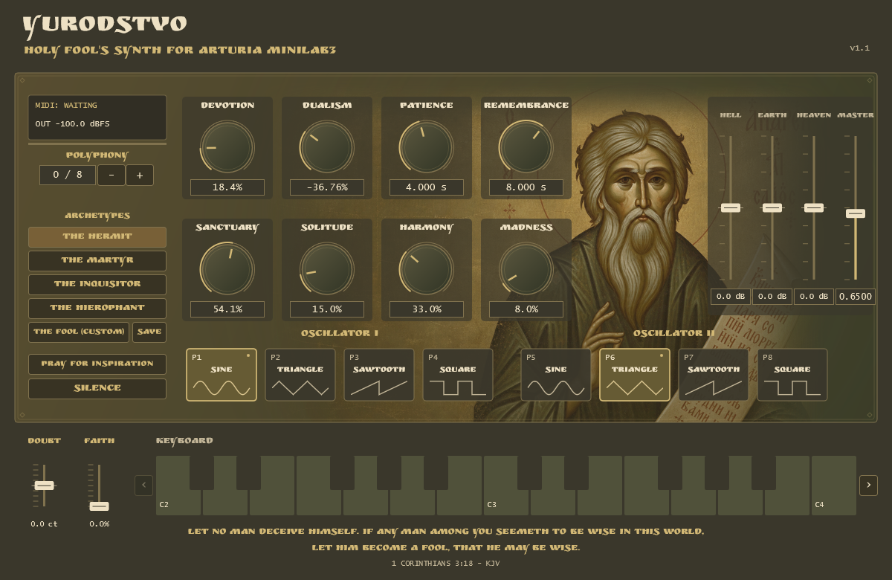

# YURODSTVO — Holy Fool's Synth for Arturia MiniLab3

**Version 1.1.0 — the current official stable release**, shown as **v1.1** in the
editor. An independent musical instrument for ambient, drones and unstable,
slowly evolving textures, inspired by holy foolishness, Orthodox iconography,
church bells and sacred acoustic space. Free and open source: **AGPL-3.0-only**.

[Download v1.1.0](https://github.com/Shilemir/yurodstvo-holy-fools-pad-engine/releases/tag/v1.1.0)
· [Latest stable release](https://github.com/Shilemir/yurodstvo-holy-fools-pad-engine/releases/latest)



## Download and installation

End users do not need JUCE, Visual Studio, a compiler or separate font/image files.
Choose the binary ZIP under Assets, not GitHub's automatic source archives.

**VST3:** download `YURODSTVO-v1.1.0-Windows-x64-VST3.zip`, extract everything,
close the DAW and copy the entire `YURODSTVO - Holy Fool's Synth for Arturia MiniLab3.vst3`
bundle to `C:\Program Files\Common Files\VST3`. Preserve all Contents subfolders.
Restart/rescan and load the instrument on a MIDI/instrument track. Keep only one
version in scanned directories: the VST3 identity is unchanged. Back up projects
before upgrading from 0.x, whose sound ranges and hardware fader order differ.

**Standalone:** download `YURODSTVO-v1.1.0-Windows-x64-Standalone.zip`, extract
and run `YURODSTVO - Holy Fool's Synth for Arturia MiniLab3.exe`. Select audio/MIDI
in Options / Audio-MIDI Settings if needed. Keep the LICENSES folder with it.
Start at a moderate Master/monitor level. No driver or runtime installer is bundled.

Check the ZIPs against `SHA256SUMS.txt` from the same release, for example:
`Get-FileHash .\YURODSTVO-v1.1.0-Windows-x64-VST3.zip -Algorithm SHA256`.

## Instrument

- Dual oscillators, each with Sine, Triangle, Sawtooth and Square; independent pads.
- DEVOTION — octave Shimmer; DUALISM — oscillator balance.
- PATIENCE — Attack; REMEMBRANCE — Release, both up to 20 seconds.
- SANCTUARY — Cathedral Reverb; SOLITUDE — BPM-synchronized stereo Delay.
- HARMONY — note-tracking bell resonances, recurring independently every 3–9 seconds.
- MADNESS — smooth controlled pitch, amplitude, timbre and stereo instability.
- Three-band EQ: HELL (120 Hz shelf), EARTH (1 kHz bell), HEAVEN (6 kHz shelf),
  each −15 to +15 dB, followed by global MASTER volume and final peak protection.
- Up to 16 voices, velocity, sustain, host automation and stored plugin state.
- Interactive two-octave keyboard, octave navigation and real-envelope Release Glow.
- Standalone computer keyboard: A/W/S/E/D/F/T/G/Y/H/U/J/K plays C through C
  from the visible first C (initially MIDI 48); the octave arrows move its range.
  Playing requires the active editor, releases notes on focus loss and does not
  capture DAW keyboard shortcuts in VST3.
- Five Archetypes, PRAY FOR INSPIRATION and Arturia MiniLab 3 MIDI integration.
- Embedded official illustration and unmodified Ruslan Display font.

SOLITUDE follows quarter-note / dotted-quarter-note taps at valid host tempo
30–300 BPM. Without valid host tempo it keeps the last valid value, initially
120 BPM; tempo changes crossfade without resetting the delay. FAITH (CC1) is
visual only. DOUBT/Pitch Bend is a global ±100 cent gesture for both oscillators,
preserving their relative detune. The legacy detune parameter remains compatible.

Harmony's final calibration already includes **+2 dB** on both initial and
recurring bell returns. THE HIEROPHANT has **HELL = −1.0 dB**; no extra gain is
added by the release packaging. The final safety knee can reduce apparent gain
at extreme settings. Glow follows the main voice envelope; bells and global
reverb/delay tails can remain audible after a key goes dark. SILENCE clears them.

## Five Archetypes

| Archetype | Character |
|---|---|
| THE HERMIT | Contemplation |
| THE MARTYR | Suffering |
| THE INQUISITOR | Judgment |
| THE HIEROPHANT | Transcendence |
| THE FOOL (CUSTOM) | User-defined sound |

The four factory sounds are fixed, artist-calibrated configurations. **SAVE**
stores eight macros, three EQ bands and both waveforms in
`%APPDATA%\YURODSTVO\custom-preset-v1.json`. **THE FOOL (CUSTOM)** recalls that
user-defined sound only when clicked. Missing/invalid files leave the sound
unchanged. Master, expression, polyphony and MIDI routing are not saved in this
Custom slot. Host projects independently retain their own plugin state.

In 1.1.0, new instances start with THE HERMIT and eight voices. Restoring a
saved host state overrides those defaults; reopening the editor never resets
the sound. THE HERMIT, THE MARTYR and THE INQUISITOR use the new calibrated
settings in [VERSION-1.1.md](VERSION-1.1.md); THE HIEROPHANT remains unchanged.

**PRAY FOR INSPIRATION** creates unpredictable combinations of those 13 existing
parameters rather than choosing a factory preset. Master, expression, polyphony
and routing remain unchanged. Generated values notify the host and save normally.
A manual sound edit can mark a selected archetype as MODIFIED.

## Arturia MiniLab 3

Both existing User and DAW CC maps are supported on any MIDI channel. The DAW
must forward notes, CC and Pitch Bend; a control-surface script can intercept them.
The instrument also works with other compatible MIDI input and its mouse keyboard;
no Arturia software is required to run the instrument.

| Control | Function | User CC | DAW CC |
|---|---|---:|---:|
| E1 | DEVOTION / Shimmer | 74 | 86 |
| E2 | DUALISM / Balance | 71 | 87 |
| E3 | PATIENCE / Attack | 76 | 89 |
| E4 | REMEMBRANCE / Release | 77 | 90 |
| E5 | SANCTUARY / Reverb | 93 | 110 |
| E6 | SOLITUDE / Synced Delay | 18 | 111 |
| E7 | HARMONY / Bells | 19 | 116 |
| E8 | MADNESS / Instability | 16 | 117 |
| F1 | HELL / Bass | 82 | 14 |
| F2 | EARTH / Mid | 83 | 15 |
| F3 | HEAVEN / Treble | 85 | 30 |
| F4 | MASTER / Volume | 17 | 31 |

E1–E8 interpret consecutive absolute CC values as movement relative to the current
sound after prayer/preset/state/mouse edits. If no physical value is known, the
first value establishes a baseline; a control at 0/127 cannot send more movement
in that direction. EQ faders use pickup after preset changes; mouse-edited Master
also uses pickup. The F1–F4 order above is the current order, changed since 0.10.1.

P1–P4 choose oscillator I waveforms; P5–P8 choose oscillator II. Default pads use
notes 36–43 or CC102–109. The full pad-control octave 36–47 is reserved and silent;
identical note/channel input from a physical key cannot be distinguished from a
pad. Custom pad mappings remain supported. The keyboard opens at MIDI 48–72
(C2–C4 in the instrument's display); arrows move the view without transposing notes
and avoid the reserved octave. Mouse and physical MIDI ownership are independent.
Mouse notes are not emitted as MIDI output to a DAW clip.

## Requirements and validation limits

Windows x64. VST3 needs a 64-bit VST3 instrument host; Standalone needs a working
audio output. Built/tested on the development Windows 11 machine with an offline
JUCE VST3 host. The owner reports earlier Ableton Live 11 use; no new Ableton,
physical MiniLab, listening, other-PC, Windows 10/ARM or all-DAW test is claimed.
Binaries are unsigned. Official packages use the static MSVC runtime and normal
Windows system libraries. Stable release status is the owner's reference-version
designation, not a claim of testing on every host/device.

## Source and building

See [BUILDING.md](BUILDING.md). CMake 3.22+ (new enough for your generator), a C++17
Windows toolchain/SDK and JUCE **9.0.4** are required. The tested toolchain is
Visual Studio 2026/MSVC 19.51. CMake can fetch the exact official JUCE revision
`3fb5cbc0340758596dac39f7c8de47d562b4896e`, accept `JUCE_PATH`, or discover
`dependencies/JUCE` in the complete `YURODSTVO-v1.1.0-Corresponding-Source.zip`
release asset for offline builds. JUCE is not vendored in the Git repository.

```powershell
cmake -S . -B build -G "Visual Studio 18 2026" -A x64
cmake --build build --config Release --target Yurodstvo_Standalone Yurodstvo_VST3 YurodstvoTests --parallel 4
ctest --test-dir build -C Release --output-on-failure
```

`release/build-distribution.ps1` creates a clean Release build, runs checks and
packages both formats. No tools are installed by these scripts. See
[release/VALIDATION.md](release/VALIDATION.md) and the published release notes for
measured results. Original private development history remains local; the public
repository extends the reviewed public snapshot without rewriting its history.

## Licensing and artwork

YURODSTVO - Holy Fool's Synth for Arturia MiniLab3 is free and open-source software licensed
under the **GNU Affero General Public License, version 3 only**. You may download
and use the instrument free of charge, study its source, modify it, redistribute
it and your own versions under the AGPLv3, and contribute improvements. Commercial
use and sale are allowed; there is no noncommercial-use restriction.

When conveying binaries, provide recipients with the complete Corresponding
Source under the AGPLv3, including your modifications and build/install scripts,
using a method allowed by section 6. Preserve copyright and licence notices,
identify changes and dates, and license covered modified works under AGPLv3.
If you modify the program and let users interact with it remotely over a network,
section 13 requires a prominent opportunity for those users to obtain that
version's Corresponding Source at no charge. Merely using the local instrument
does not require publishing private music or private modifications. Audio you
create is not automatically licensed under AGPLv3 by using this synthesizer.

Read [LICENSE.txt](LICENSE.txt), [COPYRIGHT.md](COPYRIGHT.md) and
[THIRD_PARTY.md](THIRD_PARTY.md). JUCE is used under its open-source AGPLv3 option,
not the JUCE Starter/commercial path. Third-party terms remain intact, including
Ruslan Display's SIL OFL 1.1. No proprietary-host linking exception is granted
for JUCE; see the dependency audit for the scope of this distribution review.

The owner's rights, if any, in `assets/yurodstvo_icon.png` are dedicated under
CC0 1.0. AI authorship and third-party-rights limitations are documented in
[assets/ILLUSTRATION-NOTICE.txt](assets/ILLUSTRATION-NOTICE.txt). CC0 does not apply
to the font, third-party code or the entire interface screenshot.

Contributions are welcome through issues and pull requests. Submit original
application-code contributions under AGPL-3.0-only and retain existing notices;
no copyright assignment is requested. See [CONTRIBUTING.md](CONTRIBUTING.md).
