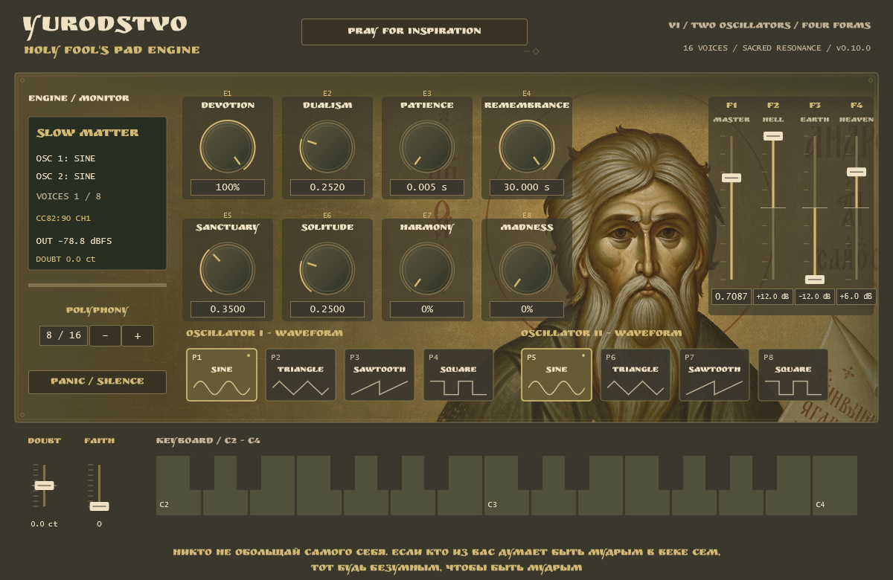

# YURODSTVO — Holy Fool's Pad Engine

An experimental synthesizer for ambient music, drones and slowly evolving sound
textures, inspired by Orthodox iconography and the tradition of holy foolishness.
Open-source software under **GNU AGPL v3.0 only (AGPL-3.0-only)**.
Current application version: **0.8.0**; open-source distribution: **v0.8.0-agpl**.



The screenshot is rendered from the real JUCE editor with demonstration values.

## Download

Open this repository's **Releases** section and choose the **v0.8.0-agpl prerelease**.
Download the Windows-VST3 or Windows-Standalone ZIP under **Assets**.
GitHub's automatic Source code archives are not ready-to-run binaries.
End users do not need JUCE, Visual Studio, CMake or compilation.

## Installation — VST3

1. Download `YURODSTVO-Holy-Fools-Pad-Engine-v0.8.0-Windows-VST3.zip`.
2. Extract the complete archive and close your DAW.
3. Copy the entire `YURODSTVO - Holy Fool's Pad Engine.vst3` folder into
   `C:\Program Files\Common Files\VST3`. Keep all nested Contents folders intact.
   Administrator permission may be required for this copy.
4. Restart the DAW, enable VST3 system folders and rescan plugins.
5. Load the instrument on a MIDI/instrument track and start at a moderate volume.

For Ableton Live 11: Preferences > Plug-Ins > enable VST3 system folders > Rescan.
Keep only one version of this plugin in scanned directories; its identity is
stable across upgrades. Back up DAW projects before upgrading.

## Installation — Standalone

1. Download `YURODSTVO-Holy-Fools-Pad-Engine-v0.8.0-Windows-Standalone.zip`.
2. Extract everything and run `YURODSTVO - Holy Fool's Pad Engine.exe`.
3. If needed, use Options / Audio-MIDI Settings to select your audio output and
   MIDI input. No MIDI controller is required for the on-screen mouse keyboard.
4. Start at a moderate Master level. Keep the LICENSES folder with the app.

## Features

- Two oscillators per voice, each with Sine, Triangle, Sawtooth and Square.
- Independent waveform selection, oscillator mix and oscillator II detune.
- Selectable 1–16 voice polyphony, default 8; velocity and physical MIDI sustain.
- Attack and Release up to 30seconds, smooth parameter changes and voice stealing.
- Three-band EQ before effects: Bass 120Hz shelf, Mid 1kHz bell, Treble 6kHz shelf,
  each −12 to +12 dB, neutral at 0 dB.
- Global octave Shimmer, stereo Reverb and Delay, plus final peak protection.
- Mouse-playable C2–C4 keyboard, waveform pads and MiniLab 3-inspired controls.
- Host parameter automation and plugin-state storage.
- Embedded official AI illustration and Ruslan Display font; no external assets
  need to be installed next to the binaries.

## Basic controls

| Control | Function | User CC | DAW CC |
|---|---|---:|---:|
| E1 | Shimmer amount |74|86|
| E2 | Oscillator Mix |71|87|
| E3 | Attack |76|89|
| E4 | Release |77|90|
| E5 | Reverb |93|110|
| E6 | Delay |18|111|
| E7/E8 | Reserved/inactive |—|—|
| F1 | Master Volume |82|14|
| F2 | Bass |83|15|
| F3 | Mid |85|30|
| F4 | Treble |17|31|

Both absolute 0–127 MiniLab 3 maps are accepted on any MIDI channel. The DAW must
forward notes, CC and Pitch Bend to the instrument; control-surface/Remote routing
may intercept them. Preserve your working controller setup.

P1–P4 select Sine/Triangle/Sawtooth/Square for oscillator I; P5–P8 do the same forII.
Default pad routing accepts notes 36–43 or CC102–109 on any channel. Pad releases
keep the selection. Old saved custom pad mappings remain supported internally.

Pitch Bend controls **oscillator II detune**,−100 to+100cents, centre 0; it is not a
global bend of both oscillators. Its physical gesture is temporary; record MIDI
Pitch Bend in the DAW to replay it. The separate Pitch Detune parameter supports
host automation. Legacy Detune automation retains its former range for old sets.
ModulationCC1 displays 0–127 but has no sound destination yet.

Click and hold a key with the left mouse button, drag between keys, then release.
Leaving the keyboard, losing focus or closing the editor releases the mouse note.
Mouse and physical MIDI ownership are independent but share the polyphony limit.
Long Release/effect tails may continue naturally. PANIC / SILENCE clears them.
Mouse notes are not emitted as MIDI output to the DAW; use physical MIDI for clips.
The Polyphony selector sets 1–16voices without assigning a hardware knob.

## Requirements and limits

Windows x64; VST3 requires a 64-bit VST3 instrument host. Standalone requires a
working audio output. Built/tested locally on Windows 11; the owner reports earlier
Ableton Live 11 operation. This does not validate all DAWs or other computers.
Windows 10 and Windows on ARM are not independently validated.

Official release packages use the statically linked MSVC runtime. Inspected
imports require normal Windows system DLLs, without external VCRUNTIME/MSVCP
runtime DLLs. No driver or runtime installer is bundled. Binaries are unsigned;
contact the maintainer if blocked rather than disabling system protection.

This is a prerelease under active development. Heavy EQ boosts and dense effect
settings can engage the final safety knee. Shimmer's windowed pitch shifting can
introduce a soft granular/chorused texture. 

## Source and development

The public repository begins with a reviewed 0.8.0 snapshot. The owner retains the
complete, unmodified development history locally; former external reference images
and that history are not published here. No application DSP was changed for release.

Dependencies: CMake 3.22 or newer (new enough for your chosen generator), Git and
Visual Studio C++ build tools with a Windows SDK. The tested toolchain is Visual
Studio 2026/MSVC 19.51. CMake fetches official **JUCE 9.0.4**, verifies commit
`3fb5cbc0340758596dac39f7c8de47d562b4896e`, and uses its AGPLv3 option.
JUCE is not vendored in this Git repository. Internet access is needed on the
first configure unless you use the complete source archive or supply JUCE_PATH.

```powershell
cmake -S . -B build -G "Visual Studio 18 2026" -A x64
cmake --build build --config Release --target Yurodstvo_Standalone Yurodstvo_VST3 YurodstvoTests --parallel 4
ctest --test-dir build -C Release --output-on-failure
```

`release/build-distribution.ps1` makes a fresh Release x64 build with static MSVC
runtime, tests it and packages both formats. No tools are installed by the scripts.
For an offline build, download the **Corresponding-Source.zip** asset from the
same release: it contains this project and the exact JUCE source, discovered
automatically at `dependencies/JUCE`. Alternatively configure with
`-DJUCE_PATH="C:/path/to/JUCE-9.0.4"` using an unmodified official checkout.
See [BUILDING.md](BUILDING.md) for tools, generators and packaging instructions,
and TEST_REPORT.md for technical validation and its limits.

## Licensing and artwork

YURODSTVO — Holy Fool's Pad Engine is free and open-source software licensed
under the **GNU Affero General Public License, version 3 only**. You may download
and use the instrument free of charge, study its source, modify it, redistribute
it and your own versions under the AGPLv3, and contribute improvements. Commercial
use and sale are allowed; there is no noncommercial-use restriction.

When conveying binaries, provide recipients with the complete Corresponding
Source under the AGPLv3, including your modifications and build/install scripts,
using a method allowed by section 6. Preserve copyright and licence notices,
identify changes and dates, and license covered modified works under AGPLv3.
If you modify the program and let users interact with it remotely over a network,
section 13 requires a prominent opportunity for those users to obtain that
version's Corresponding Source at no charge. Merely using the local instrument
does not require publishing private music or private modifications. Audio you
create is not automatically licensed under AGPLv3 by using this synthesizer.

Read [LICENSE.txt](LICENSE.txt), [COPYRIGHT.md](COPYRIGHT.md) and
[THIRD_PARTY.md](THIRD_PARTY.md). JUCE is used under its open-source AGPLv3 option,
not the JUCE Starter/commercial path. Third-party terms remain intact, including
Ruslan Display's SIL OFL 1.1. No proprietary-host linking exception is granted
for JUCE; see the dependency audit for the scope of this distribution review.

The owner's rights, if any, in `assets/yurodstvo_icon.png` are dedicated under
CC0 1.0. AI authorship and third-party-rights limitations are documented in
[assets/ILLUSTRATION-NOTICE.txt](assets/ILLUSTRATION-NOTICE.txt). CC0 does not apply
to the font, third-party code or the entire interface screenshot.

Contributions are welcome through issues and pull requests. Submit original
application-code contributions under AGPL-3.0-only and retain existing notices;
no copyright assignment is requested. See [CONTRIBUTING.md](CONTRIBUTING.md).
